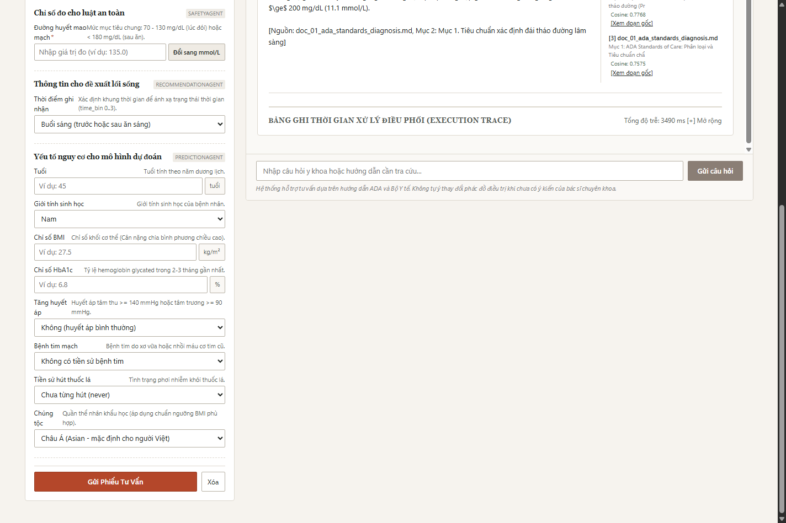
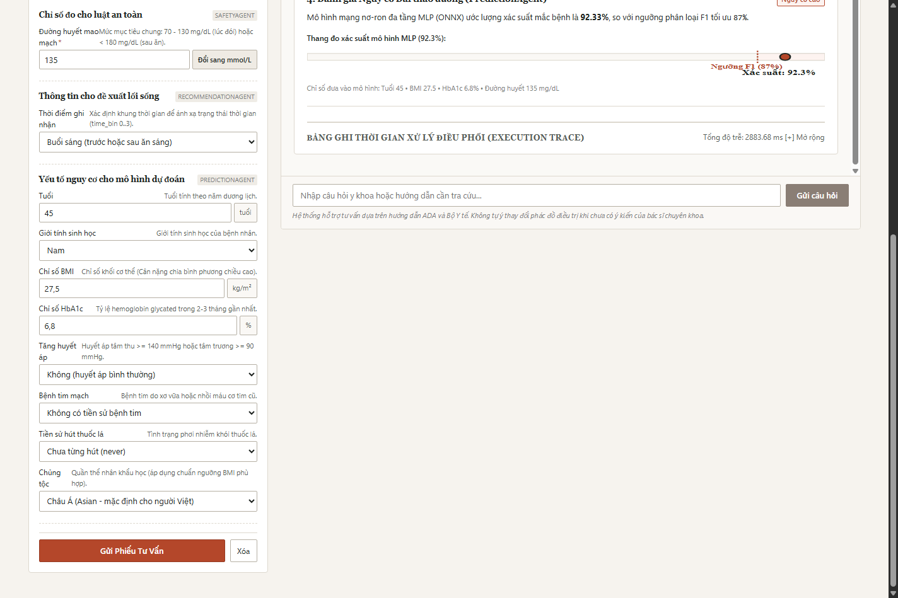
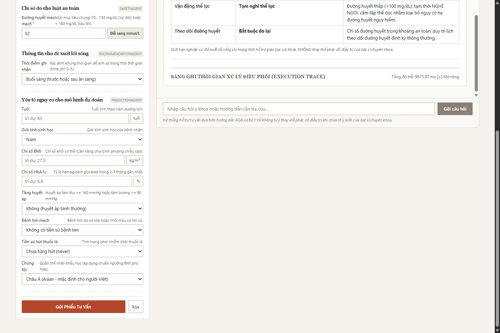
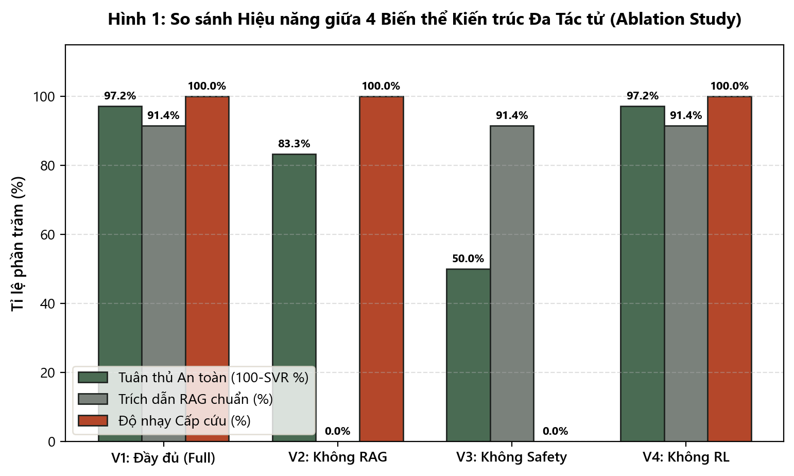
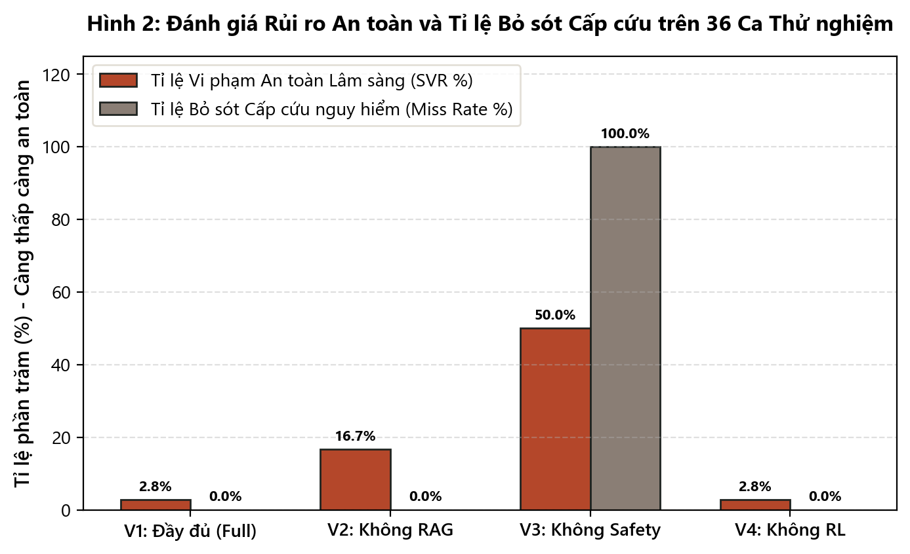
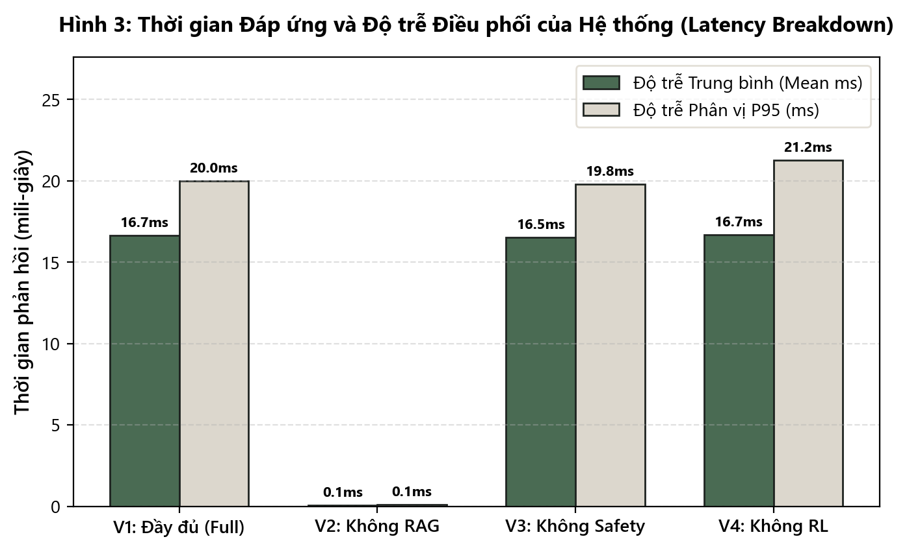

# BÁO CÁO DỰ ÁN: CHƯƠNG 5 VÀ CHƯƠNG 6

---

# CHƯƠNG 5: CÀI ĐẶT HỆ THỐNG VÀ THỰC THI THỰC TẾ

## 5.1. Công nghệ và môi trường triển khai

Bảng 5.1 tổng hợp môi trường triển khai thực tế.

| Thành phần | Công nghệ | Phiên bản |
| :--- | :--- | :--- |
| Core & API | FastAPI, Uvicorn | 0.162, 0.54 |
| Dự báo MLP | ONNX Runtime | 1.22.1 |
| Tri thức RAG | Sentence-Transformers | 6.2.0 |
| Mô hình sinh | Google GenAI SDK | 1.28.0 |
| RL & Luật | NumPy, PyYAML | 2.4.6, 6.0.3 |
| Giao diện | React, Vite | 19.3, 8.3 |

**Bảng 5.1. Công nghệ và môi trường thực thi thực tế**

---

## 5.2. Cấu trúc mã nguồn và danh mục API

Cây thư mục rút gọn:
```text
PROJECT_CODE/
├── backend/app/  # FastAPI, 4 agents
├── frontend/     # React, Vite
├── models/       # ONNX, RAG, RL, rules
├── reports/      # metrics, figures
└── scripts/      # demo, eval
```

5 API RESTful chính thức:
- `GET /api/health`: Kiểm tra 4 model (503 nếu thiếu).
- `POST /api/consult`: Tiếp nhận và điều phối 4 tác tử.
- `POST /api/predict`: ONNX MLP dự báo nguy cơ.
- `GET /api/rules`: Danh mục quy tắc `rules.yaml`.
- `GET /api/trace/{id}`: Truy vết phiên tư vấn.

---

## 5.3. Ba kịch bản demo vận hành thực tế

### Kịch bản 1: Hỏi đáp kiến thức y khoa

**Hình 5.1. Giao diện Kịch bản 1**

*Phân tích Kịch bản 1 (63 từ):*
Bộ điều phối nhận diện ý định `knowledge_query`, gọi `KnowledgeAgent` (22.78 ms) và `SafetyAgent` (0.05 ms). `KnowledgeAgent` truy xuất 3 đoạn trích từ `doc_01_ada_standards_diagnosis.md` đạt độ tương đồng 0.8104. `SafetyAgent` rà soát, xác nhận không vi phạm an toàn y tế (`rules_triggered: []`) và cấp trạng thái `PASS`. Phiên xử lý hoàn tất, hiển thị kết quả có trích dẫn nguồn văn bản trong 22.91 ms.

### Kịch bản 2: Tư vấn chỉ số lâm sàng

**Hình 5.2. Giao diện Kịch bản 2**

*Phân tích Kịch bản 2 (64 từ):*
Ý định phân loại `clinical_consultation`, kích hoạt 4 tác tử: `PredictionAgent` (0.42 ms), `RecommendationAgent` (0.03 ms), `KnowledgeAgent` (21.34 ms), `SafetyAgent` (0.07 ms). `PredictionAgent` dự báo xác suất 0.9233 (vượt ngưỡng 0.87), xếp loại nguy cơ cao. `RecommendationAgent` tra trạng thái 8 ra hành động 6 (Carb vừa, vận động vừa). `KnowledgeAgent` trích tài liệu WHO, Bộ Y tế. `SafetyAgent` duyệt `PASS`. Tổng độ trễ toàn phiên là 21.92 ms.

### Kịch bản 3: Cảnh báo khẩn cấp VETO

**Hình 5.3. Giao diện Kịch bản 3**

*Phân tích Kịch bản 3 (63 từ):*
Bộ điều phối nhận diện `emergency`, gọi `RecommendationAgent` (0.03 ms), `KnowledgeAgent` (15.76 ms), `SafetyAgent` (0.08 ms). `SafetyAgent` phủ quyết (`status: "VETO"`), kích hoạt 5 luật: `RULE_01`, `RULE_04_HYPO_REQUIRE_CARB`, `RULE_05`, `RULE_05_MANDATORY_MONITORING`, `EMERGENCY_HYPOGLYCEMIA`. Hệ thống ngắt vận động, nâng mức tinh bột, ép cảnh báo theo dõi sát và đưa khuyến cáo cấp cứu lên đầu trong 15.93 ms.

---

# CHƯƠNG 6: THỰC NGHIỆM VÀ ĐÁNH GIÁ HỆ THỐNG

## 6.1. Thiết kế thí nghiệm

Thực nghiệm tiến hành độc lập theo giao thức `docs/eval_protocol.md` (seed 42) trên 35 câu hỏi tri thức (`rag_questions_approved.json`) và 36 ca lâm sàng biên (`safety_cases.json`). Các chỉ số tuân thủ công thức: truy xuất tri thức tại Mục 4.1 (Hit@k, MRR, Citation %), an toàn lâm sàng và độ nhạy cấp cứu tại Mục 4.2 (SVR %, Sensitivity, Miss Rate, RL Conflict), cùng độ trễ tại Mục 4.4 để so sánh 4 biến thể.

---

## 6.2. Tổng hợp kết quả từng thành phần độc lập

Bảng 6.1 tổng hợp số liệu cốt lõi Chương 4.

| Thành phần | Tập kiểm thử | Chỉ số chính | Kết quả thực tế |
| :--- | :--- | :--- | :--- |
| **Prediction (MLP)** | 20.000 mẫu | Acc/Prec/Rec/F1/ROC-AUC/Brier | 0.9705, 0.9512, 0.6878, 0.7984, 0.9752, 0.0674 |
| **Knowledge (RAG)** | 35 câu hỏi | Hit@1/Hit@3/MRR/Citation/Cosine | 68.57%, 85.71%, 0.7571, 91.43%, 0.7113 |
| **Recommendation (RL)** | 24 trạng thái | Hội tụ / Không gian | Hội tụ sau 5.000 episodes / 12 hành động |
| **Safety (Rule)** | 36 ca biên | Rà soát / Quyền VETO | < 0.10 ms / 6 nhóm luật ADA, QĐ 5481 |

**Bảng 6.1. Tổng hợp số liệu kỹ thuật các mô hình độc lập**

---

## 6.3. Thí nghiệm cắt bỏ từng thành phần (Ablation Study)

Kết quả 4 biến thể tại Bảng 6.2 từ `reports/metrics/system_eval.json`.

| Chỉ số thực nghiệm | V1_Full | V2_NoRAG | V3_NoSafety | V4_NoRL |
| :--- | :---: | :---: | :---: | :---: |
| Trích dẫn (Citation) | **91.43%** | 0.00% | 91.43% | 91.43% |
| Hit@1/Hit@3 | **68.6%/85.7%** | 0.0%/0.0% | 68.6%/85.7% | 68.6%/85.7% |
| Thứ hạng MRR | **0.7571** | 0.0000 | 0.7571 | 0.7571 |
| **Vi phạm SVR** | **2.78%** | 16.67% | **50.00%** | 2.78% |
| **Nhạy cấp cứu** | **100.0%** | 100.0% | **0.0%** | 100.0% |
| **Bỏ sót cấp cứu** | **0.0%** | 0.0% | **100.0%** | 0.0% |
| Can thiệp RL | 50.00% | 50.00% | 0.00% | 58.33% |
| Điểm thưởng | 23.72 | 22.61 | **12.19** | 24.56 |
| Trễ TB/p95 (ms) | 16.7/20.0 | 0.08/0.11 | 16.5/19.8 | 16.7/21.3 |

**Bảng 6.2. Ma trận so sánh kết quả thực nghiệm cắt bỏ giữa 4 biến thể**


**Hình 6.1. Biểu đồ 4 biến thể**


**Hình 6.2. An toàn lâm sàng**


**Hình 6.3. Phân rã độ trễ**

*Phân tích kết quả thí nghiệm cắt bỏ (115 từ):*
Thành phần đóng góp then chốt nhất là **SafetyAgent**. Khi loại bỏ tác tử này (V3_NoSafety), tỷ lệ vi phạm an toàn tăng vọt lên 50.00%, bỏ sót cấp cứu chạm 100.0% và điểm thưởng giảm còn 12.19 do đề xuất sai lệch. Điều này chứng minh học máy xác suất không thể tự bảo đảm an toàn y tế nếu thiếu luật tiền định. Về điểm chưa đạt, V1_Full còn 2.78% vi phạm do ca biên `CASE_BD_01` sát ngưỡng 130 mg/dL không kích hoạt cờ nhắc đo nghiêm ngặt như nhãn gán. V4_NoRL có điểm thưởng (24.56) nhỉnh hơn V1 (23.72) do heuristic tĩnh cố định ít tinh bột, ngẫu nhiên trùng đa số ca đường huyết cao nhưng làm tăng xung đột bị can thiệp lên 58.33%.

---

## 6.4. Thảo luận và Đánh giá tính hợp lệ

*Đánh giá mục tiêu nghiên cứu (Mục 1.3 và Bảng 3.1):*
Hệ thống vượt mục tiêu phân loại nguy cơ (NFR1: ROC-AUC 0.9752 so với 0.85; F1 đạt 0.7984) và hiệu năng (NFR3: trễ 16.66 ms so với trần 3.500 ms). Về an toàn (NFR2), đạt độ nhạy cấp cứu 100.0%, bỏ sót 0.0%, loại trừ kê đơn thuốc. Tuy nhiên, Hit@3 RAG dừng ở 85.71%, chưa đạt mục tiêu ($\ge 90\%$) do kho ngữ liệu chỉ có 24 đoạn trích, và vi phạm còn 2.78% ở ca biên nhạy cảm.

*Các mối đe dọa đến tính hợp lệ (Threats to Validity):*
- **Dữ liệu khảo sát:** Khảo sát dịch tễ cắt ngang, thiếu chuỗi thời gian liên tục (CGM).
- **Môi trường mô phỏng:** 24 trạng thái RL chưa bao quát toàn bộ bệnh nền phức tạp.
- **Tập kiểm thử:** 35 câu hỏi RAG và 36 ca an toàn tự biên soạn, chưa qua thử nghiệm mù đôi.

---

## BẢNG DANH MỤC HÌNH ẢNH TRONG BÁO CÁO

| Số hình | Tên tệp ảnh thực tế |
| :---: | :--- |
| **Hình 5.1** | `reports/figures/ui_scenario_1.png` |
| **Hình 5.2** | `reports/figures/ui_scenario_2.png` |
| **Hình 5.3** | `reports/figures/ui_scenario_3.png` |
| **Hình 6.1** | `reports/figures/f_sys_ablation_comparison.png` |
| **Hình 6.2** | `reports/figures/f_sys_safety_metrics.png` |
| **Hình 6.3** | `reports/figures/f_sys_latency_breakdown.png` |

---

## DANH SÁCH [THIẾU]

- `[THIẾU]`: Thử nghiệm lâm sàng có bác sĩ nội tiết giám sát.
- `[THIẾU]`: Dữ liệu cảm biến đo đường huyết liên tục (CGM).
- `[THIẾU]`: Mở rộng trạng thái RL cho bệnh lý đa bệnh mạn tính.
